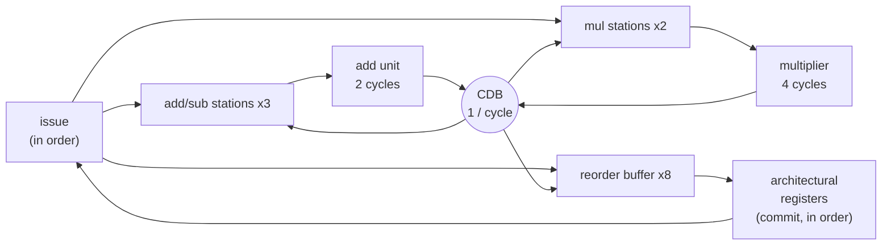

# Tomasulo's Algorithm with a Reorder Buffer

**Topic:** Chapter 3 (Instruction-Level Parallelism) · **Editions:** dynamic scheduling grows into a major topic in the 2nd
edition; the reorder-buffer ("hardware speculation") form implemented here is the one the 3rd edition and later
present · **Files:** [`sv/tomasulo_rob.sv`](sv/tomasulo_rob.sv), [`vhdl/tomasulo_rob.vhd`](vhdl/tomasulo_rob.vhd)

## Background

An in-order pipeline stalls whenever an instruction has to wait for an operand, even if later instructions are
independent. **Dynamic scheduling** lets those later instructions go ahead. Three problems must be solved:

| Hazard | Example | Cure |
|--------|---------|------|
| **RAW** (true dependence) | `ADD r4,r1,r5` needs `r1` from the `MUL` before it | wait in a **reservation station** until the value is broadcast |
| **WAR** (anti-dependence) | a later write to `r1` must not clobber the value an earlier `ADD` still needs | **register renaming** |
| **WAW** (output dependence) | two writes to `r1`; the older one must not win | **register renaming** + in-order commit |

Tomasulo's algorithm (from the IBM 360/91) solves them with:

* **Reservation stations** holding each waiting instruction together with its operand *values* or *tags* naming the producer;
* a **common data bus (CDB)** that broadcasts `(tag, value)`; every station waiting on that tag captures the value;
* **renaming** through a register-status table: the destination register is renamed to the tag of the producing instruction.

Adding a **reorder buffer (ROB)** makes the tag a ROB slot and separates *completion* from *commit*: instructions
execute and broadcast out of order, but results are written to the architectural registers strictly **in program
order**, so the machine always has a precise state. (This is also the mechanism that makes speculation past branches
possible; see the exercises.)

## Design



* **ISA:** `ADD`, `SUB`, `MUL` on 8 registers (`rd = rs op rt`), 32-bit. No branches or memory, so the focus stays on scheduling.
* **Resources** (generics): `NADD = 3`, `NMUL = 2` stations; **one** non-pipelined add unit (`ADD_LAT = 2`) and **one**
  multiplier (`MUL_LAT = 4`); `ROBN = 8` ROB entries; one CDB. If both units finish in the same cycle the adder wins
  and the multiplier holds its result until the bus is free.
* **Operand capture at issue:** a source register that is not renamed is read from the register file; one that is renamed
  is taken from the ROB if that entry is already complete, from the CDB if it is being broadcast right now, and otherwise
  the station records the tag and waits.
* When several stations are ready for a unit, the **lowest-numbered** one starts first (not necessarily the oldest). That is harmless here, but with speculation it is not: see
  [`tomasulo_spec`](../tomasulo_spec), which selects the oldest ready station and explains why.
* `issue_ready` is low when the ROB is full or no station of the right kind is free: the front end sees back-pressure.

**Exact timing** (counting clock edges; edge 1 accepts the first instruction):

| Step | Edge |
|------|------|
| issue | `I` |
| execution starts (earliest) | `I + 1` |
| result computed ("done") | start + latency |
| CDB broadcast, ROB entry complete, stations capture the value | next edge |
| commit (only at the ROB head) | next edge |

So an independent `ADD` commits at `I + 5` and an independent `MUL` at `I + 7`.

## Verification

**Hand-derived schedule.** Three instructions, `r2 = 3, r3 = 4, r5 = 10`:

```
I0: MUL r1 = r2 * r3        I1: ADD r4 = r1 + r5        I2: ADD r6 = r2 + r3
```

| Edge | Event |
|-----:|-------|
| 1 | I0 issued; `r1` renamed to ROB0 |
| 2 | I1 issued (waits for ROB0); I0 starts on the multiplier |
| 3 | I2 issued (operands ready) |
| 4 | I2 starts on the adder |
| 6 | I2 and I0 are both *done* |
| 7 | CDB: **I2 wins** (adder priority) -- a later instruction completes before an earlier one |
| 8 | CDB: I0 broadcasts; I1 captures `r1` off the bus |
| 9 | **I0 commits**; I1 starts |
| 11 | I1 done |
| 12 | CDB: I1 |
| 13 | **I1 commits** |
| 14 | **I2 commits** -- already complete since edge 7, but must wait its turn |

The testbench asserts the broadcast edges (7, 8, 12), the commit edges (9, 13, 14), the commit order and the values
(12, 22, 7); it also asserts that a lone `ADD` commits at issue + 5 and a lone `MUL` at issue + 7.

**Renaming.** `I0: MUL r1 = r2*r3`, `I1: ADD r4 = r1 + r5` (reads the *old* `r1`), `I2: ADD r1 = r5 + r5` (writes `r1` again,
and finishes first). `I1` must see 12, the final `r1` must be 20 (the later write), and `r4` must be 22.

**Random programs.** 40 programs of 120 random instructions over 8 registers (so the 8-entry ROB and the 2 multiplier
stations fill up constantly). Each is also executed *sequentially* in the testbench; the committed `(register, value)`
stream must match that golden execution instruction by instruction, and the final register file must match. The test
fails if the issue back-pressure path is never exercised (it is: 10 558 stall cycles in both languages).

## Run it

From this module directory, run the SystemVerilog testbench:

```bash
iverilog -g2012 -s tb_tomasulo_rob -o /tmp/tb_tomasulo_rob.vvp sv/tomasulo_rob.sv sv/tb_tomasulo_rob.sv
vvp /tmp/tb_tomasulo_rob.vvp
```

For VHDL-2008:

```bash
mkdir -p /tmp/ghdl-tomasulo_rob
ghdl -a --std=08 --workdir=/tmp/ghdl-tomasulo_rob vhdl/tomasulo_rob.vhd vhdl/tb_tomasulo_rob.vhd
ghdl -e --std=08 --workdir=/tmp/ghdl-tomasulo_rob tb_tomasulo_rob
ghdl -r --std=08 --workdir=/tmp/ghdl-tomasulo_rob tb_tomasulo_rob
```
## Exercises

1. Add a **branch** with prediction and a ROB flush -- done in [`tomasulo_spec`](../tomasulo_spec); try the variants listed in its exercises.
2. Add `LOAD`/`STORE` with an address queue and memory disambiguation.
3. Make the functional units **pipelined** and add a second CDB; plot IPC against the number of buses.
4. Remove the ROB (write registers at broadcast time) and demonstrate an imprecise state after an exception.
5. Compare cycles against an in-order issue for a long chain of dependent `MUL`s interleaved with independent `ADD`s.

## Textbook reference

John L. Hennessy and David A. Patterson, *Computer Architecture: A Quantitative Approach*, Chapter 3, “Instruction-Level Parallelism and Its Exploitation.”
